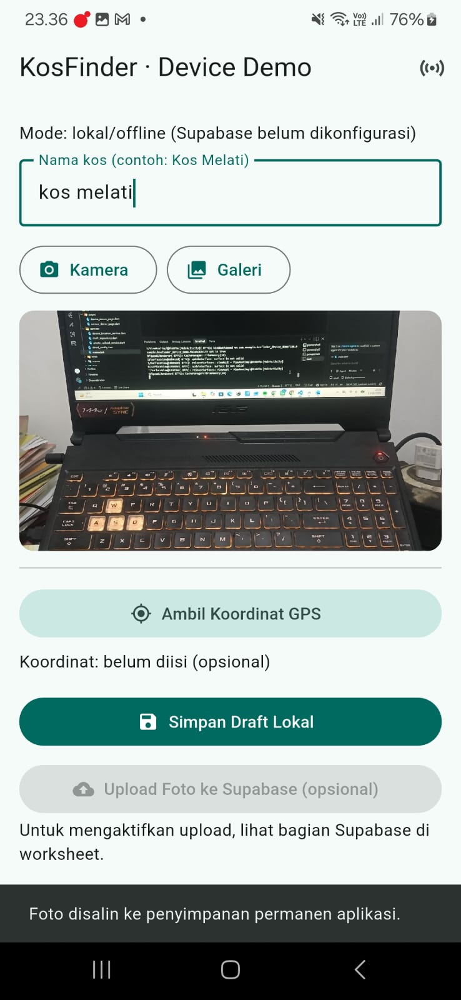
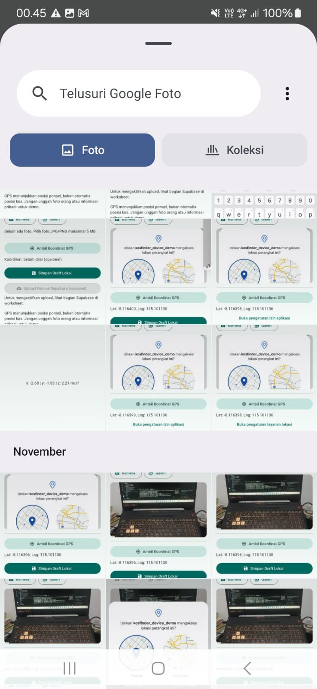
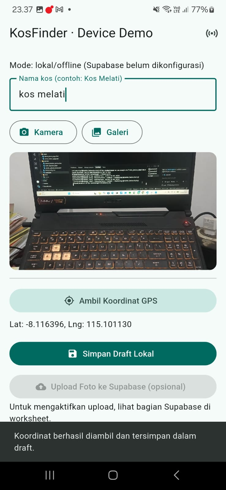
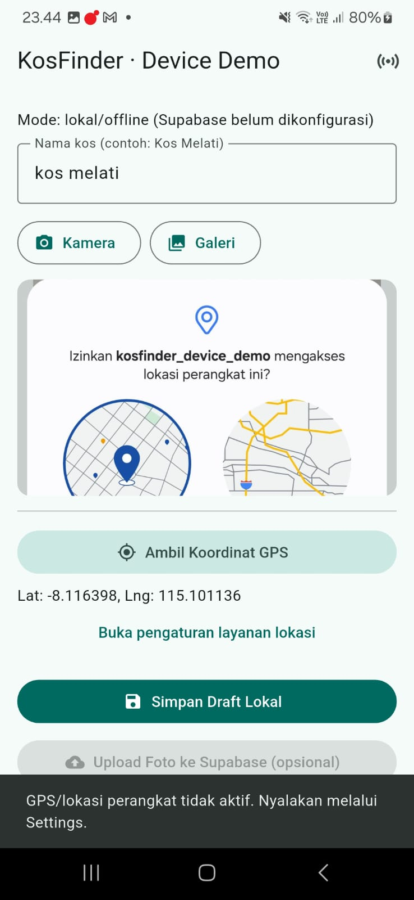
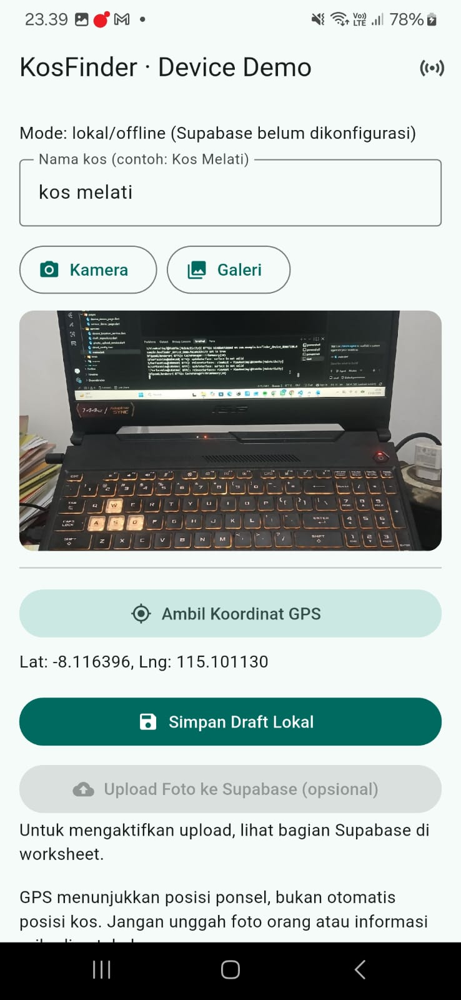
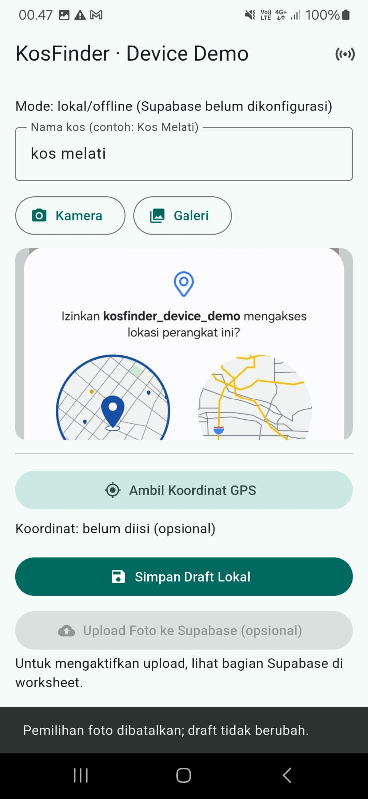
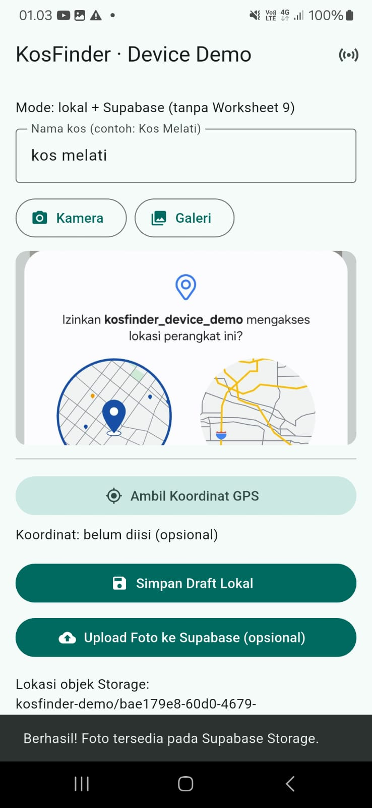
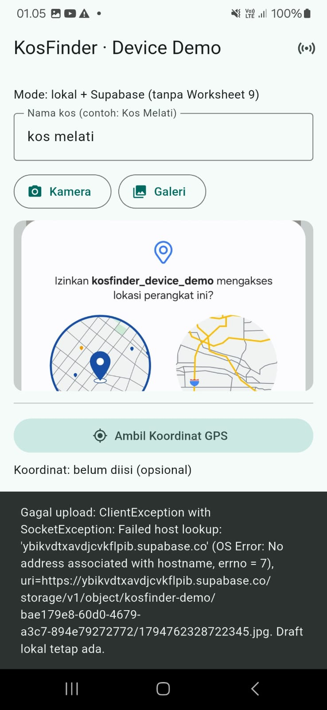
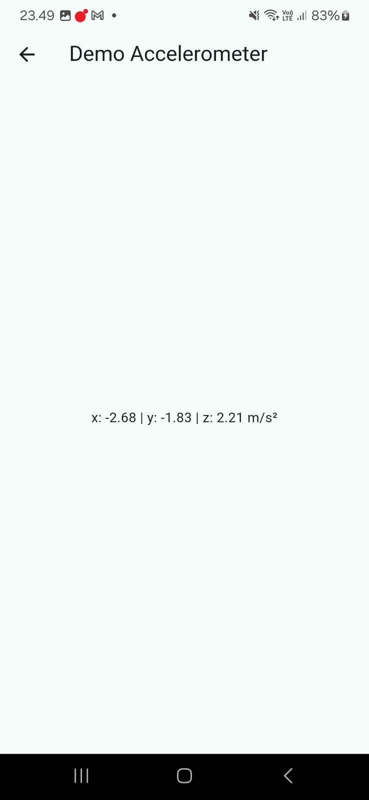

# KosFinder Device Demo

Aplikasi demonstrasi berbasis Flutter untuk mempraktikkan integrasi fitur perangkat mobile, pengelolaan izin akses, penyimpanan data lokal, dan integrasi layanan cloud menggunakan Supabase.

Project ini dikembangkan sebagai bagian dari praktikum **Pemrograman Mobile – Worksheet 10: Advanced Mobile Features & Device Integration**.

## Deskripsi Proyek

KosFinder Device Demo merupakan aplikasi demonstrasi yang mengimplementasikan berbagai fitur perangkat Android, seperti kamera, galeri, GPS, penyimpanan lokal, dan sensor accelerometer.

Aplikasi ini dirancang untuk memahami bagaimana aplikasi mobile berinteraksi dengan perangkat keras dan layanan sistem operasi, termasuk penanganan izin akses serta pengelolaan data agar tetap tersedia setelah aplikasi ditutup dan dibuka kembali.

Selain fitur lokal, aplikasi juga menyediakan pengayaan integrasi Supabase Storage untuk mengunggah foto ke penyimpanan cloud menggunakan Anonymous Sign-In dan Row Level Security (RLS).

## Tujuan Pengembangan

1. Memahami integrasi fitur perangkat mobile menggunakan Flutter.
2. Mengimplementasikan pengambilan foto melalui kamera dan galeri.
3. Menerapkan pengaksesan lokasi perangkat menggunakan GPS.
4. Mengelola izin akses perangkat dan menangani kondisi ketika izin ditolak.
5. Menerapkan penyimpanan foto dan metadata secara lokal.
6. Memahami penggunaan sensor accelerometer pada perangkat Android.
7. Mengintegrasikan Supabase Storage sebagai layanan penyimpanan cloud opsional.

## Fitur Aplikasi

### 1. Kamera dan Galeri
- Mengambil foto menggunakan kamera perangkat.
- Memilih foto dari galeri.
- Menampilkan pratinjau foto yang dipilih.
- Menyalin foto ke penyimpanan permanen aplikasi.
- Membatasi format foto JPG, JPEG, dan PNG.
- Membatasi ukuran foto maksimal 5 MB.
- Menangani pembatalan pemilihan foto.

### 2. GPS dan Lokasi Perangkat
- Mengakses lokasi perangkat menggunakan GPS.
- Meminta izin lokasi saat fitur digunakan.
- Menampilkan koordinat latitude dan longitude.
- Menangani kondisi izin lokasi ditolak.
- Menangani kondisi izin lokasi ditolak secara permanen.
- Mendeteksi ketika layanan GPS perangkat dinonaktifkan.

### 3. Penyimpanan Draft Lokal
- Menyimpan nama kos dan metadata foto secara lokal.
- Menyimpan koordinat lokasi yang diperoleh dari GPS.
- Menyimpan foto pada Application Documents Directory.
- Menggunakan SharedPreferencesAsync untuk menyimpan metadata dalam format JSON.
- Memulihkan data ketika aplikasi dibuka kembali.
- Mendukung penyimpanan dan pemulihan data tanpa koneksi internet.

### 4. Supabase Storage (Pengayaan)
- Mengintegrasikan Supabase sebagai penyimpanan cloud.
- Menggunakan Anonymous Sign-In untuk membuat sesi pengguna.
- Mengunggah foto ke bucket `kosfinder-demo`.
- Menggunakan folder berdasarkan UID pengguna.
- Menerapkan Row Level Security (RLS) untuk membatasi lokasi upload.
- Menampilkan hasil upload dan URL foto.
- Menangani kegagalan upload ketika perangkat offline.

### 5. Accelerometer (Pengayaan)
- Membaca data sensor accelerometer perangkat.
- Menampilkan perubahan nilai sumbu X, Y, dan Z.
- Menggunakan stream sensor untuk memperbarui nilai secara langsung.
- Mengelola subscription sensor agar dihentikan ketika halaman ditutup.

## Teknologi dan Dependencies

| Teknologi | Kegunaan |
|---|---|
| Flutter | Framework pengembangan aplikasi mobile |
| Dart | Bahasa pemrograman |
| image_picker | Mengakses kamera dan galeri |
| geolocator | Mengakses GPS dan lokasi perangkat |
| path_provider | Mengakses direktori penyimpanan aplikasi |
| shared_preferences | Menyimpan metadata lokal |
| supabase_flutter | Integrasi Supabase |
| sensors_plus | Membaca data accelerometer |

## Struktur Folder

```text
lib/
├── pages/
│   ├── device_demo_page.dart
│   └── sensor_demo_page.dart
│
├── services/
│   ├── device_location_service.dart
│   ├── draft_repository.dart
│   └── photo_upload_service.dart
│
├── cloud_config.dart
└── main.dart

test/
└── widget_test.dart

android/
ios/
linux/
macos/
web/
windows/

assets/
└── screenshots/

.gitignore
.metadata
analysis_options.yaml
pubspec.lock
pubspec.yaml
README.md
```

### Penjelasan Struktur Folder

- `pages/`: Berisi halaman utama demonstrasi perangkat dan halaman accelerometer.
- `services/`: Berisi layanan pengelolaan lokasi, penyimpanan draft lokal, dan upload foto ke Supabase.
- `cloud_config.dart`: Mengatur konfigurasi koneksi Supabase menggunakan environment variables.
- `main.dart`: Menjadi titik masuk aplikasi dan mengatur inisialisasi Supabase secara kondisional.
- `test/`: Berisi pengujian aplikasi.
- `assets/screenshots/`: Menyimpan dokumentasi screenshot hasil implementasi dan pengujian.

## Persyaratan Sistem

Sebelum menjalankan project, pastikan perangkat pengembangan sudah memiliki:

- Flutter SDK.
- Dart SDK (termasuk dalam Flutter).
- Android Studio atau Visual Studio Code.
- Android SDK.
- Perangkat Android atau emulator.
- Koneksi internet untuk instalasi dependencies.

## Instalasi dan Menjalankan Aplikasi

### 1. Clone Repository

```bash
git clone https://github.com/ekabawa/kosfinder_device_demo.git
```

### 2. Masuk ke Direktori Project

```bash
cd kosfinder_device_demo
```

### 3. Instal Dependencies

```bash
flutter pub get
```

### 4. Periksa Konfigurasi Flutter

```bash
flutter doctor
```

### 5. Jalankan Aplikasi

Untuk menjalankan aplikasi dalam mode lokal tanpa konfigurasi Supabase:

```bash
flutter run
```

Aplikasi tetap dapat menggunakan fitur kamera, galeri, GPS, sensor, dan penyimpanan draft lokal tanpa konfigurasi Supabase.

## Konfigurasi Supabase (Opsional)

Supabase digunakan sebagai fitur pengayaan untuk mengunggah foto ke penyimpanan cloud.

### 1. Persiapan Supabase

Buat project Supabase baru, kemudian lakukan konfigurasi berikut:

- Aktifkan Anonymous Sign-In.
- Buat Storage Bucket dengan nama `kosfinder-demo`.
- Atur bucket sebagai Public untuk foto demonstrasi nonprivat.
- Atur batas ukuran file maksimal 5 MB.
- Izinkan MIME types `image/jpeg` dan `image/png`.
- Terapkan Storage Policy menggunakan Row Level Security (RLS).

### 2. Menyiapkan Environment Variables

Aplikasi menggunakan `String.fromEnvironment` untuk membaca konfigurasi Supabase.

Jalankan aplikasi dengan perintah berikut:

```bash
flutter run \
  --dart-define=SUPABASE_URL=YOUR_PROJECT_URL \
  --dart-define=SUPABASE_PUBLISHABLE_KEY=YOUR_PUBLISHABLE_KEY
```

Ganti nilai berikut sesuai konfigurasi project Supabase:

- `YOUR_PROJECT_URL`: URL project Supabase.
- `YOUR_PUBLISHABLE_KEY`: Publishable Key Supabase.

**Catatan Keamanan:**

Jangan memasukkan Secret Key atau `service_role` ke dalam aplikasi Flutter maupun repository GitHub. Gunakan hanya Publishable Key untuk konfigurasi aplikasi client.

Bucket Public memungkinkan foto dibaca oleh siapa pun yang memiliki URL. Gunakan foto demonstrasi yang tidak mengandung informasi pribadi.

## Pengujian Aplikasi

Pengujian dilakukan menggunakan perangkat Samsung Galaxy A15 dengan sistem operasi Android 14.

Beberapa skenario pengujian yang telah dilakukan meliputi:

| No. | Skenario Pengujian | Hasil |
|---|---|---|
| 1 | Mengambil foto melalui kamera | Berhasil |
| 2 | Memilih foto melalui galeri | Berhasil |
| 3 | Membatalkan pemilihan foto | Berhasil |
| 4 | Pengujian penolakan izin kamera/galeri | Belum diuji secara khusus |
| 5 | Memberikan izin GPS | Berhasil |
| 6 | Menolak izin GPS | Berhasil |
| 7 | Menonaktifkan GPS | Berhasil |
| 8 | Memulihkan draft setelah aplikasi dibuka ulang | Berhasil |
| 9 | Menyimpan draft tanpa internet | Berhasil |
| 10 | Mengunggah foto ke Supabase Storage | Berhasil |
| 11 | Mengunggah foto ketika offline | Berhasil ditangani (upload gagal, draft tetap tersedia) |
| 12 | Menguji sensor accelerometer | Berhasil |

## Dokumentasi Screenshot

Screenshot berikut digunakan untuk memperlihatkan hasil implementasi dan pengujian aplikasi.

### 1. Tampilan Aplikasi


### 2. Kamera dan Galeri





### 3. GPS dan Lokasi






### 4. Penyimpanan Draft Lokal





### 5. Supabase Storage





### 6. Accelerometer



> Catatan: Nama file screenshot di atas harus disesuaikan dengan file yang benar-benar dimasukkan ke folder `assets/screenshots/`.

## Informasi Pengembang

**Nama Project:** KosFinder Device Demo

**Mata Kuliah:** Pemrograman Mobile

**Praktikum:** Worksheet 10 – Advanced Mobile Features & Device Integration

**Platform:** Android

**Framework:** Flutter

**Repository GitHub:**  
https://github.com/ekabawa/kosfinder_device_demo

## Lisensi

Project ini dikembangkan untuk keperluan pembelajaran dan praktikum Pemrograman Mobile.